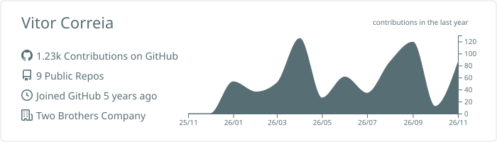
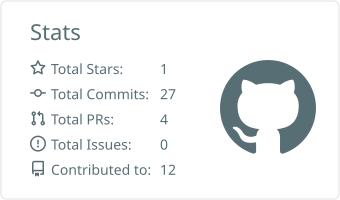
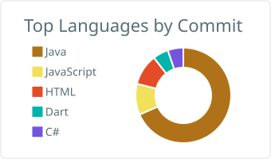

# Vitor Correia

Mobile Software Engineer based in São Paulo, Brazil, building native and cross-platform iOS and Android applications.

I work primarily with **Flutter**, **Dart**, **Kotlin**, **Swift**, **Java**, and **Firebase** — shipping reliable, well-tested apps and contributing bug fixes and improvements upstream to open-source libraries in the mobile and JVM ecosystems.

---

### Open Source Contributions

<!--START_SECTION:oss-->
  

<b>Open / Under Review</b> · 3 pull requests

| Repository | Pull Request | Opened |
| --- | --- | --- |
| [apache/logging-log4j2](https://github.com/apache/logging-log4j2) | [Synchronize Category.aai access in log4j-1.2-api (#4512)](https://github.com/apache/logging-log4j2/pull/4525) | 2026-11-24 |
| [foresightmobile/flutter_markdown_plus](https://github.com/foresightmobile/flutter_markdown_plus) | [Run test/all.dart in validate.sh and register missing tests](https://github.com/foresightmobile/flutter_markdown_plus/pull/185) | 2026-11-24 |
| [kerberjg/color_palette_extractor.dart](https://github.com/kerberjg/color_palette_extractor.dart) | [Fix RangeError when image has fewer colors than paletteSize](https://github.com/kerberjg/color_palette_extractor.dart/pull/3) | 2026-11-24 |

<!--END_SECTION:oss-->

---

### Tech Stack

**Mobile** &nbsp;

**Backend, Cloud & Tools** &nbsp;

---

### GitHub Analytics

  <picture>
    <source media="(prefers-color-scheme: dark)" srcset="https://raw.githubusercontent.com/vitor-correia/vitor-correia/stats/github_dark/0-profile-details.svg">
    
  </picture>

  <picture>
    <source media="(prefers-color-scheme: dark)" srcset="https://raw.githubusercontent.com/vitor-correia/vitor-correia/stats/github_dark/3-stats.svg">
    
  </picture>
  <picture>
    <source media="(prefers-color-scheme: dark)" srcset="https://raw.githubusercontent.com/vitor-correia/vitor-correia/stats/github_dark/2-most-commit-language.svg">
    
  </picture>
  <picture>
    <source media="(prefers-color-scheme: dark)" srcset="https://streak-stats.demolab.com/?user=vitor-correia&theme=github-dark-blue&hide_border=true">
    
  </picture>

<picture>
  <source media="(prefers-color-scheme: dark)" srcset="https://raw.githubusercontent.com/vitor-correia/vitor-correia/output/github-contribution-grid-snake-dark.svg">
  
</picture>
